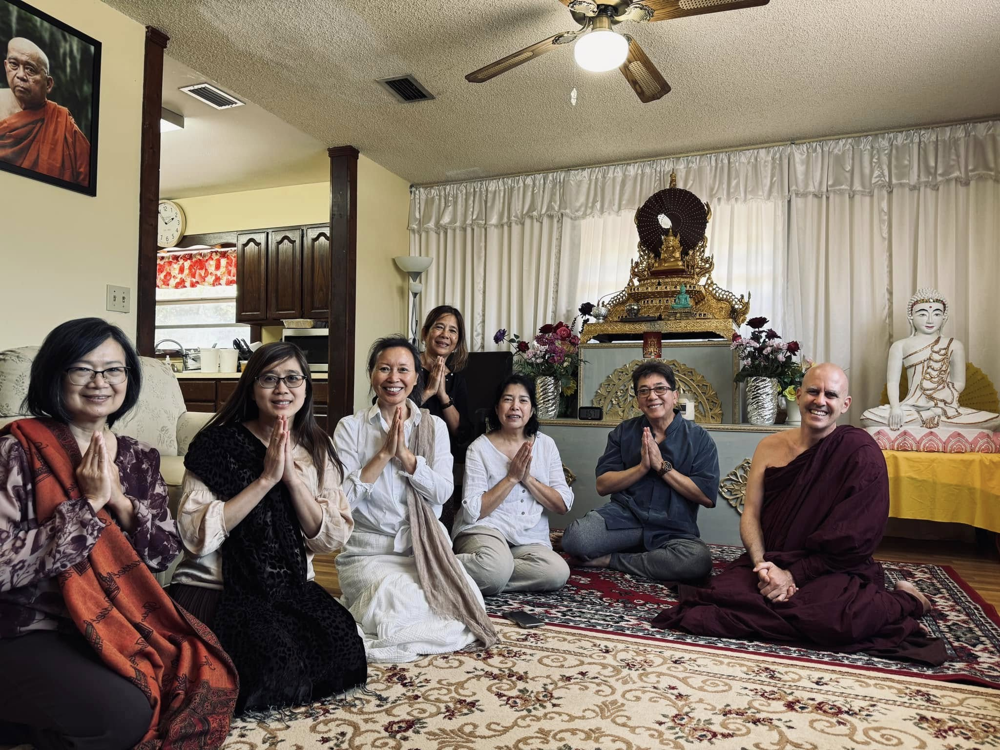

On **May 28, 2024**, five generous donors visited **Tayzawbatha (Florida Buddhist Monastery)** to offer the daily meal (*dāna*) to the resident monk.

Their visit was filled with joy, devotion, and wholesome merit as they gathered for blessings, Dhamma discussion, and fellowship.

The Chinese donor on the 3rd left is the original property donor of Pa-Auk Florida.
---

### 📸 Photo

  
---

May the merits of this lead to Nibbāna!
